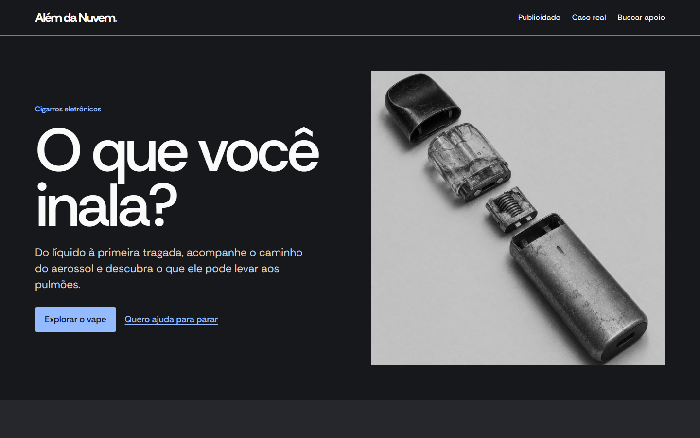
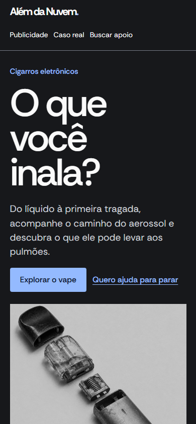

# Além da Nuvem

**O que você inala quando usa um vape?** O Além da Nuvem é um site educativo em português, criado para uma campanha escolar sobre cigarros eletrônicos. O visitante pode explorar o dispositivo, examinar um anúncio e escolher orientações para uma situação que esteja vivendo.

[Acessar o site da campanha](https://alem-da-nuvem-vape-escola.younggoldfinch64.chatgpt.site) · O acesso à versão hospedada depende de permissão.

## Como é a experiência

- **Por dentro do vape.** Ao selecionar o bocal, o reservatório ou a resistência, o visitante acompanha o caminho do líquido até o aerossol. Uma seção expansível explica os possíveis efeitos nos pulmões, no coração e no cérebro.
- **O que o anúncio omite?** Uma pergunta sobre uma publicidade fictícia convida a turma a examinar o que o sabor anunciado revela sobre a quantidade de nicotina. Cada resposta recebe uma explicação.
- **Um caso real.** Uma radiografia acompanha o relato de um estudante de 23 anos que passou sete dias na UTI com lesão pulmonar associada ao uso de vape. [Relato clínico original](https://pubmed.ncbi.nlm.nih.gov/33815967/)
- **E se acontecer comigo?** O visitante escolhe entre três situações: receber uma oferta, apoiar um amigo ou buscar ajuda para parar. A página inicial também oferece um atalho direto às orientações para quem quer parar.

## Capturas de tela

### PC · 1440 × 900

### Celular · 390 × 844

## Stack do site

| Tecnologia | Uso no projeto |
| --- | --- |
| HTML5 | Estrutura da página, navegação por âncoras e painéis expansíveis com `details` e `summary`. |
| CSS | Layout responsivo com Grid e Flexbox, tema escuro, fonte Rethink Sans local e animações que respeitam a preferência por movimento reduzido. |
| JavaScript | Seleção das peças do vape, respostas da atividade sobre publicidade e abertura da orientação escolhida. |
| Canvas 2D | Desenho dos pulmões e das ramificações dos brônquios no navegador. |

O site é estático. HTML, estilos, scripts, fonte e imagens são servidos diretamente ao navegador. Na distribuição offline, basta extrair o ZIP e abrir `site/index.html`. As interações funcionam localmente; os links para artigos e instituições precisam de internet.

## Fontes e créditos

O conteúdo educativo remete aos materiais do [INCA](https://www.gov.br/inca/pt-br/assuntos/causas-e-prevencao-do-cancer/tabagismo/dispositivos-eletronicos-para-fumar), da [Anvisa](https://www.gov.br/anvisa/pt-br/assuntos/tabaco/cigarro-eletronico/arquivos/os-022022-ggtab-atualiza-os-032020-parte-1-impacto-a-saude.pdf), do [CDC](https://www.cdc.gov/tobacco/e-cigarettes/health-effects.html) e do [Ministério da Saúde](https://linhasdecuidado.saude.gov.br/portal/tabagismo/sou-paciente/).

A imagem do vape desmontado é uma ilustração gerada por IA. A radiografia é a figura 1 do relato de Adhikari e colaboradores, publicado em *Cureus* em 2021 sob licença [CC BY 3.0](https://creativecommons.org/licenses/by/3.0/).
